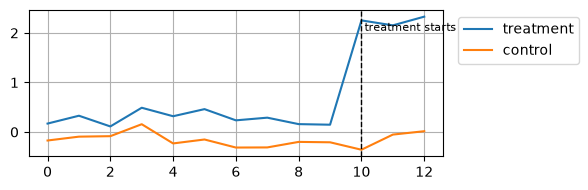
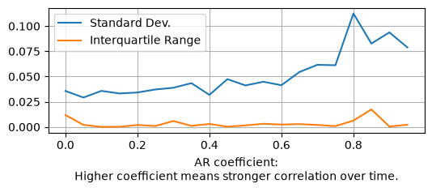
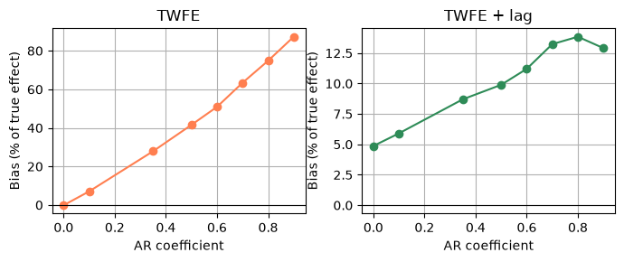
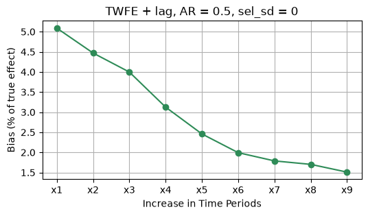

In this article, I will use simulations and simple algebra to show  how even when you know the true data generating process, your 
causal model can still be biased and noisy. 

## Autoregressive in Difference in Difference (DiD) Models 
We'll focus on the difference in difference (DiD) estimator, a common econometric model for using trends to estimate causal impacts.  

### Brief Primer on DiD
DiD is for cases where we can track units over time (called panel data). From this, we track when units start to be treated. Usually units are geographic locations. For example, we can estimate the impact of 
introducing new grocery items in stores comparing its earnings trend before and after launch to that of stores without the new items.

Instead of directly comparing the outcomes over the treatment and control group, DiD compares the pre vs post changes. This gives
DiD its name: we are taking the difference of two differences!

* Control Difference = Control-Post - Control-Pre

* Treatment Difference = Treatment-Post - Treatment-Pre 

Intuitively, if the treatment trend increases more than the control trend did, then the treatment increased the outcome. 

::: {.text-center}
**Difference-in-Difference in a Figure**

**We interpret the deviation from trend after treatment starts for the treatment group as due to treatment.**

:::

This estimate is typically modeled with the following OLS regression:

$$ y_{it} = \pi W_{it} + \tau_t + \iota_i + \epsilon_{it} $$

The DiD estimate is $\pi$. This regression, called a two-ways fixed effect model, achieves the DiD estimate because by separately controlling for the time-specific variation and unit-specific variation, we can 
isolate the change in pre-vs-post trends with $W_{it}$. 

In this regression: 
* $y_{it}$ is the outcome for observation $i$ in time period $t$; 
* $W_{it}$ indicates that a treatment unit is in the treatment period; 
* $\tau_t$ is a time fixed effect that removes time-specific variation - for example, earnings spikes on Fridays; and
* $\iota_i$ is a unit fixed effect that removes unit-fixed variation - for example certain stores earn a lot because they are in cities. We will 
revisit $\iota_i$ next. 

### Autoregressive data generating function
A common modification to the two-ways fixed effects model is to control for the lagged outcome. The usual
motivation is that there is an autoregressive pattern to our data.

The first reason is that treatment is not random and depends on the lagged outcome. This is reasonable outside of pure experimental setups when 
we are estimating the impact of policies designed to increase the outcome. For example, we are introducing new products in stores in the hopes 
of boosting their future sales. 

The second reason is that outcomes are naturally correlated over time . For example, store earnings are correlated over time not because 
of weekday vs weekend patterns or that they are located in cities, but that high earnings one day 
bring in more customers and earnings the next day. 

Incorporating selection into this, we modify the true data generating process as:
$$
\begin{align}
y_{it} & = \alpha y_{it-1} + \pi W_{it} + \tau_t + \iota_i + \epsilon_{it}  \\
W_{it} &= f(y_{it-1}) 
\end{align}
$$

If we believe that our outcome is autoregressive, then the variance in outcomes is higher. Below we show that with strong autoregression,
the variance in outcomes over time increases. Intuitively this is because randomly large and small values of $\epsilon_{it} $ persist over time. 

::: {.text-center}
**Autoregression increases variance in outcomes**

:::

Based on this, we just add $y_{it-1} $ into our regression model. 

So, no new issues and smooth sailing, right? Come on, if this was smooth sailing why would I be writing about it? 

## Bias and imprecision 
Simulations will show there is an issue here. You can find the simulation notebook at [this git repo link](https://github.com/shoepaladin/causalinference_crashcourse/blob/main/OtherMaterial/General%20Points%20about%20Estimating%20Treatment%20Effect%20Models/AR%20Bias%20in%20Panel%20Models.ipynb). We simulate a data-generating process
that is an AR process:
$$
\begin{align}
y_{it} & = \alpha y_{it-1} + \pi W_{it} + \tau_t + \iota_i + \epsilon_{it} \\
W_{it} &= f(y_{it-1}) 
\end{align}
$$

Across simulations, we vary the strength of the autoregression. Higher values of $\alpha$ mean more correlated outcomes over time and as the previous figure shows, adds more noise in our data.

But this should not be a problem since we know the true data-generating process, right?  
We estimate two different models: 

|  model name | Estimating Equation |
|---|---|
|**TWFE + lag** | $y_{it} = \alpha y_{it-1} + \pi W_{it} + \tau_t + \iota_i + \epsilon_{it}$ |
|**TWFE ** |  $y_{it} = \pi W_{it}  + \tau_t + \iota_i + \epsilon_{it} $ |

We expect that the **TWFE + lag** model should give us unbiased estimates of $\pi$ regardless of the autoregressive strength. 

**The simulations show otherwise.** Both models give us biased estimates! As the model's autoregression 
increases with a higher $\alpha$ value, the bias on both models increase. Interestingly, the "TWFE + lag" model is *always* biased.

The "TWFE" performs worse than the "TWFE + lag" model, except for the no-autoregression scenario ($\alpha=0$). 

::: {.text-center}
**More Autoregression, More Bias**

:::

### Build Intuition from the Algebra 
Applying some algebra to the estimation model points to the culprit: the unit fixed effects force 
the outcome $y_{it}$ to be correlated with the error terms during estimation, thus breaking
an underlying assumption of the OLS model.

Coming back to the estimating equation, note that $\iota_i$ is a unit-specific intercept. Therefore,
our estimation equation: 
$$
y_{it} = \alpha y_{it-1} + \pi W_{it} + \tau_t + \iota_i + \epsilon_{it} 
$$

is equivalent to:
$$
\tilde{ y }_{it} = \alpha \tilde{y}_{it-1} + \pi \tilde{W}_{it} + \tau_t + \tilde{\epsilon}_{it} 
$$

where $\tilde{ (x) }$ is the unit-demeaned version of $(x)$. So  $\tilde{ y }_{it} = y_{it} - \frac{1}{N}\sum_{j=1}^{N} y_{jt}$.

This is because $W_{it}$ depends on $y_{it-1}$, which in turn depends on $\epsilon_{it-1}$. That alone is okay, but
since we are now de-meaning with the unit level average it means that $ \tilde{W}_{it} $  and $\tilde{\epsilon}_{it} $ are now correlated.
This is because:
1. $ \tilde{W}_{it} $ contains $\tilde{y}_{it-1}$, which in turn contains $\tilde{\epsilon}_{it-1}$; and 
2. $\tilde{\epsilon}_{it-1}$ contains not just $\epsilon_{it-1}$, but the entire history of $\epsilon_{it}$, which is also in $\tilde{\epsilon}_{it}$. 
3. So therefore, an unobserved error term in our estimation equation is correlated with our treatment variable. This violates an assumption for OLS to have unbiased estimates.

The simulation notebook shows that removing the fixed effects does not solve it either. 

This bias is called "Nickell Bias", so called from Stephen Nickell's paper "Biases in Dynamic Models with Fixed Effects." [JSTOR link](https://www.jstor.org/stable/1911408) and [non-JSTOR link](http://www.econ.uiuc.edu/~econ536/Papers/nickell81.pdf). 

This bias shrinks when we have more time periods in our sample. However, this has its own risks. The longer your time period, 
the harder it will be to satisfy a necessary assumption for difference-in-difference estimation. A major assumption is "parallel trends" - that 
control and treatment trends are parallel before treatment starts. When you extend your panel back in time, you will eventually find 
a period where this is not true. 

::: {.text-center}
**More Time Periods, Less Bias under Autoregressive Data**

:::

## Conclusion 
In this post, I showed with simulation and algebra that having the right data-generating process does not guarantee unbiased estimates. 
Autoregressive data poses a problem for difference-in-difference estimation when treatment is based on past outcomes. While increasing 
the time window for analysis addresses this problem, it is not a silver bullet. 
