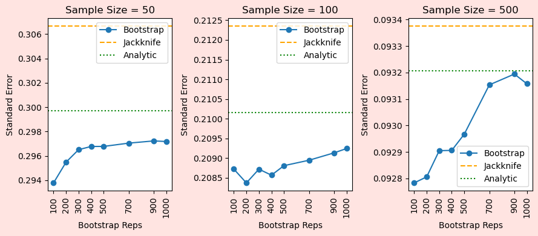

## When standard errors do not come for free
For many traditional models such as t-tests and ordinary least squares (OLS),
it is easy to calculate confidence intervals and standard errors. This is because we 
can calculate it with the data as quickly as it takes to get the estimate. For example,
if we are doing a t-test of a binary (0/1) variable, then the standard error is simply:
$$ \sqrt{ p(1-p) /  n }$$
where $p$ is the sample proportion and $n$ is the sample size. 

There are similar versions available for OLS and other simple models. In other words, there is
an *analytical equation* that tells us exactly what the standard error should
be for a dataset and model. 

However, analytical equations are not often available for more complicated models. For
example, matching models where you estimate the difference between matched units.

## Sampling solutions
Then how do we calculate the standard error?

Referring back to the definition is helpful here. The standard error represents the 
variance in the point estimate. The variation comes from a re-sampling thought experiment. If we had somehow re-created this dataset many times, as in 
different users were assigned treatment using the same process, then how much 
variation would there be in the estimate? 

The more variation in the estimate (the higher the standard error), the more
likely the estimated relationship or association is noise.

Using this definition,  we can come up with two ways to calculate the standard error
by simply resampling the data we already have. 

**Jackknife** has been a traditional approach for re-sampling. For as many rows in your data, you 
re-estimate the model. The equation is:

$$ \sqrt{ (N-1)/(N) \sum_N  ( \beta^j_i -  E[\beta^j_i]  )^2 }$$
where $\beta^j_i$ is the coefficient estimate after you remove row $i$ from the data.

Two benefits of this model are that there is a pre-determined number of re-samples you do, and you know exactly 
what the number is for a given dataset so it is reproducible.

**Bootstrap** is more popular because we have more computational power. Instead of only
removing each row for the re-sample, we re-sample the entire dataset with replacement. So for
a dataset with $N$ rows, we resample to create another dataset with $N$ rows then re-estimate on this
resampled dataset. 

This means you can re-sample as often as you want. It also makes our equation a little bit more complex.
The equation is:
$$ \sqrt{  \frac{1}{B-1} \sum_B (  s^b - E[s^b] )^2   } $$
where $s^b$ is the coefficient estimate from a bootstrap $b=1,...,B$. 

**A fundamental assumption** for both these solutions is that your current dataset is an accurate
representation of what the data would look like if you could re-create it. This can be a problem when 
your dataset is incredibly small, even if it is randomly drawn. 

It also means your jackknife/bootstrap cannot solve any bias problems. If you want to know the average
click through rate of all users, then re-sampling the click through rate of high tenure users will not get you
the answer you want. 

## Which to pick?
A clear benefit of the jackknife is that there is a set limit on how many re-samples you can do. However, the
bootstrap will get you a more accurate standard error if you have **a lot** of them.

Let's see this with simulation data. Find the notebook [here](https://github.com/shoepaladin/causalinference_crashcourse/blob/main/OtherMaterial/General%20Points%20about%20Estimating%20Treatment%20Effect%20Models/Bootstrap%20vs%20Jackknife.ipynb). Below I show three standard error definitions across datasets of different sizes. I am doing this
exercise for the standard error from an OLS regression, where I have the *analytical solution* and the correct standard error.
I am tracking the:
1. Jackknife standard error;
2. Bootstrap standard error over the number of bootstraps on the horizontal axis; and
3. Analytical standard error. 

::: {.text-center}
**Bootstrap approaches the true analytical standard error**

**Jackknife is always a bit too big**

:::
The bootstrap approaches the true standard error as we increase the number of bootstraps. With the 
larger datasets, having 1K bootstraps gets us pretty close. But this can be computationally intensive,
remember that these are pretty small datasets.

On the other hand, the jackknife is always a little bit too large. However, it takes much less computational power for smaller datasets.

Therefore, the question is whether we need the additional precision from additional bootstraps? If something is going to be statistically significant 
under a jackknife, it almost certainly also will be if you ran a bootstrap over many times more re-samples.

