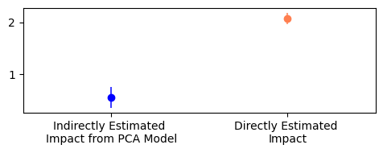

Often we need to decide how to represent a treatment in our regressions. 
This can happen whenever the treatment itself is embedded with many other things. 

Suppose we offered clients a bundle of contracts for purchasing products. Each bundle varies over multiple dimensions:
1. What products are in them;
2. The prices we would sell them at;
3. The duration of the contract; and
4. Even more.

Suppose we just want to know the impact of offering higher prices. But how would we represent all this in a regression? Each bundle is unique, so we cannot categorize them into different bins.
We would want to distinguish between the prices of different contracts, and the duration also means each price has a different weight.

## Multi-dimensional treatment
The core problem is that you want to know the impact of altering just one part of a multi-dimensional treatment. This pops up in other places: showing different ads, sequences of purchases, and watching content. 

One way to solve this problem is to use an ad-hoc defined way of measuring this part you are interested in. For example, you ignore the product and duration dimensions and just look at the change in average price. 
But if this varies a lot by product or duration, then you will have a biased estimate. The ad-hoc approach is simple but brittle.

Another way to think about this is to somehow compress this multi-dimensional space so you can at least run a simple regression on this. 
I am going to show you with simulation data that even when you do this with a low dimensional treatment, this will cause you to under-estimate the impact. 

In fact, compressing the treatment bundle you are interested in raises a lot of other complexities around interpretation and inference. We will show that next!

## Low dimensional settings for our simulation
See the full notebook [here](https://github.com/shoepaladin/causalinference_crashcourse/blob/main/OtherMaterial/General%20Points%20about%20Estimating%20Treatment%20Effect%20Models/EncodingTreatments.ipynb)!

The bundle will just be one dimension. It is low enough that we can compress it with simple principal component analysis (PCA). More complex models like a 
Gated Recurrent Unit or autoencoders can be used to compress multi-dimensional data. But the general point still stands. 

Suppose the true DGP is, for each individual $i \in N$:
$ Y_i = \tau A_{i} + f(X_i, \beta) + e_i $
Where $A_i$ is our treatment bundle. For each individual it is just a row of numbers. Technically, it is a $K \times N$ matrix. 
To further simplify it, only the first number (or first column of the matrix) actually drives impact. We actually want to know $\tau_1$.

We look at this and compress or "encode" $A_{i} $ into fewer columns. Call this compression $PCA(A_i)$. 

**A key decision** is how many components to use. Recall that we need to decide how many components we extract. If we extract the same number of components as $A_i$, then we are not compressing anything. So we must use only a few components, meaning that **our compressed features will never 100% represent the actual treatment bundle.**
If the treatment had more dimensions and we had to use more complex encoders, then we run into the same problem. We are always giving up some explanatory power to have an easier dataset to handle.

Then the actual regression we run is:
$ Y_i = \pi PCA(A_i) + f(X_i, \gamma) + e_i $
Where $ f(X_i, \gamma) $ is removing any selection bias caused by $X_i$. Trying to interpret the estimated coefficients $\pi$ leads to a key problem:

## What does the impact of an encoded feature mean?
Remember that the feature we are interested in is actually "hidden" in $PCA(A_i)$ because we encoded it. The $\tau_1$ is some weighted average of the $\pi$ estimates. 

Fortunately, we only used a PCA model. A PCA model is linear so we could back out the estimated parameters and mathematically derive $\tau_1$. 

But we are not that fortunate if we used a more complex, non-linear model. We would need to back it out by re-running our trained encoder (PCA model in this case). The steps are:

1. Calculate $PCA(A^{0}_i)$ where $A^{0}_i$ is where the feature we are interested in is set to a control value; 
2. Calculate $PCA(A^{1}_i)$ where $A^{1}_i$ is where the feature we are interested in is set to a treatment value; and
3. Calculate $\tau_1$ as $\pi PCA(A^{1}_i) - \pi PCA(A^{0}_i) $. 

## Encoded treatments mean attenuated estimates
Going through all this trouble still gives you the wrong answer. Using simulations ([available here](https://github.com/shoepaladin/causalinference_crashcourse/blob/main/OtherMaterial/General%20Points%20about%20Estimating%20Treatment%20Effect%20Models/EncodingTreatments.ipynb)!), we show that this will lead to a "backed out" estimate of $\tau_1$ that
is always smaller than the true $\tau_1$ value. Also check out the notebook for how we deal with another problem I did not talk about, which is how to get a confidence interval for this backed out $\tau_1$ estimate.

::: {.text-center}
**Comparing Estimates of $\tau_1$**

:::

Intuitively, this is because we decided to give up explanatory power by choosing to encode in the first place! 

Sometimes you have no choice but to encode because you literally cannot fit the multi-dimensional treatment into your regression. Know that your estimate will always be closer to zero than it actually is. 
It might make more sense to dive deep and understand what feature you are trying to estimate the impact on. Maybe you are trying to understand the impact of offering just a specific price or specific changes at once. 

