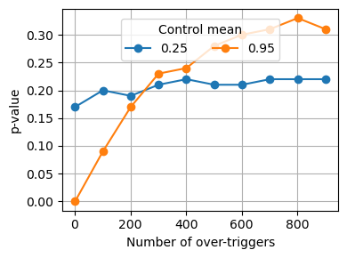
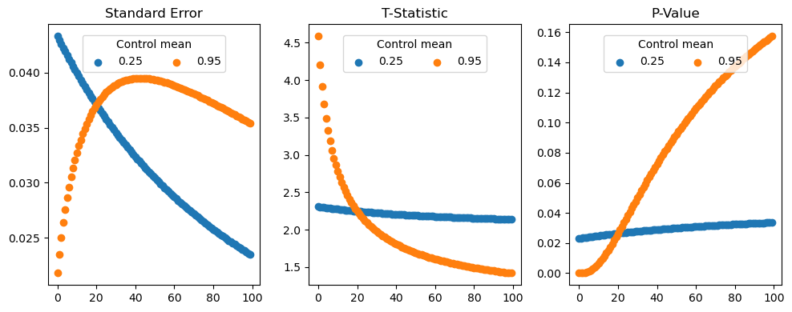

---
title: "Triggering Blanks in your AB Test and the Importance of Math over Simulations"
description: "First principles helps us where simulations fail"
date: 2026-11-03
author: "Julian Hsu"
categories: [Experiment Design, Estimation]
---


Ideally your experiment should be only users that 
experience either the treatment or control state. What happens when you include others?

This post shows that adding inactive accounts to your treatment and control leads to more false negatives.
The more "blank overtriggers" you add to your experiment, the more likely you will incorrectly
dial down treatments. 

Using my stand-by solution of simulations gave me noisy results.
To make sense of this, I used the good old pen and paper and algebra!

## AB Test Setup
Suppose we are recommending online videos to users. There is a banner that only shows 
for users if they open the website in Paris.
Clicking on the banner lets the user buy a ticked to an in-person event. 
The banner is the *only way* a user can purchase the ticket. 

We are doing an experiment to test whether a modified banner increases the chance
someone buys a ticket to the in-person event. 

Our treatment experience is seeing the modified banner, and the control
experience is seeing the usual banner. 

In this setup then, we need to:

1. Take users who are coming to the site;

2. Figure out whether they are based on Paris; and

3. If they are in Paris, randomize into treatment arms and show 
the relevant banner.

Here is a simplified flow chart:

```{mermaid}
%%| fig-cap: "Paris-Only Banner AB Test"
flowchart TD
  A[User comes to site]
  B[Location query]
  C[Paris]
  D[Not Paris]
  E{Randomize into Treatment and Control}

  A --> B
  B --> C
  B --> D
  C --> E
```

## Where can blank over triggers come from?
Looks straight forward - until you dive into the details. Here are some 
reasons why users in the treatment and control may see *neither* banner.

From a website serving standpoint, this experiment is going to load a rather large image into the homepage. 
You need to make sure that this large image loads quickly or at all if the user is in treatment. 
If it does not load correctly or takes too long, then what is the backup plan?

A solution for this can be pre-caching, where you proactively store the image in the app or device.

Pre-caching needs to happen before the user comes to the site. Therefore you need to assign
treatment status before they open the site.

If they never actually open the site, then you end up with a bunch of assigned treatment and control users that 
never opened the site and saw neither treatment and control banners.

Since many experimentation platforms require a single source of truth for treatment assignment,
this nuance may not be captured. If you only do experiments on the same page, then 
you can design your experiment to remove users who were assigned but never opened the page. However,
this is hard to identify and manage if you experiment across multiple pages and conditions. 

## "Blank overtriggers" leads to false negatives 
Let's see how the p-value from our AB test changes as we add more inactive accounts, or "blank overtriggers."

The only metric we care about in our experiment is whether users purchases a ticket for the 
in-person event. This is the conversion rate. Remember that:
* The banner is the only way to purchase the ticket; and 
* The banners are only shown to treatment/control users in Paris.

So any "blank overtriggered" users will automatically
have an outcome of 0 because they could not purchase the ticket.

### The simulations are too noisy ... 
We run simulations calculating the p-value testing whether the
treatment arm's conversion rate differs from the control arm's. 
Find the simulation notebook at this [git repo link](https://github.com/shoepaladin/causalinference_crashcourse/blob/55f92f0a6488f7f1cda19dab309f36d8aecd0330/OtherMaterial/Experiment%20Designs/mass_point_over_triggering.ipynb).


As we 
add more "blank overtriggers" that saw neither treatments and had 
conversion rates of 0%, the p-value increases.

More "blank overtriggers" increases the false negative rate, and 
gets us to ship features we should have. The "blank overtriggers" make
it harder for us to detect that the treatment banner 
actually increases conversion.

At least we can say that for when the baseline conversion rate is high (0.95). 

The slope is much flatter and noiser when the baseline conversion rate is low (0.25). 

::: {.text-center}
**Simulations show the p-value increases, even faster when control mean is high.**

**but the trend for the low control mean is noisy**


:::

But it is frustrating that the pattern is not clear for simulations 
with a low baseline converstion rate. Even more frustrating that these 
better match reality, where conversion rates are small.
How can we be certain that adding more 
"blank overtriggers" will also increase the p-value regardless 
of what the baseline conversion rate is?


### ... so we did some algebra
To remove *all* simulation noise, we analytically derive how the p-value changes 
as we add more "blank overtriggers." The p-value is a direct
function of the t-statistic, so let us start with its components: (i) the 
standard error and (ii) the estimated difference.

*(i) The standard error.* To keep this simple,
we will use a one-pool standard standard error. While this
is not exactly right because our test should use the two-proportion standard error
because there are two treatment arms, 
it will simplifies our math and does not substantially alter the result.

The standard error without the "blank overtriggers" is: 
$$ se = \sqrt{ \dfrac{p(1-p)}{n} }  $$
$$ se = n^{-1/2} [ p(1-p) ]^{1/2} $$
Where: 
* $n$ *real* data points
* $p$ probability from only the *real* data points

Then the new probability average is $p_o$:
$$ p_o = \dfrac{np}{n+ n_o}$$
Where $n_o$ is the number "blank overtriggers" at a value of zero. 
This makes the actual standard error from our overtriggered experiment:
$$se_o = \sqrt{  \dfrac{p_o ( 1-p_o)}{n + n_o} } = \sqrt{  \dfrac{ \frac{np}{n+n_o}\frac{n + n_o - np}{ n+ n_o} }{n + n_o}   }  $$

* (ii) the estimated difference.* That difference will 
get closer to zero as we add more "blank overtriggers." 
The estimated difference is:
$d_o = \dfrac{d*n}{n+n_o}$ 
Where $d$ is the difference using only $n$ real data points. Therefore, 
the t-statistic is $\dfrac{d_o}{se_o}$. 

With this definition, we can remove the simulation noise from our
previous results. We directly calculate the standard error, t-statistic, and 
p-value when we add more "blank overtriggers." 

The pattern is clear now. Adding more "blank overtriggers" always increases 
the p-value, regardless of what the baseline conversion rate is.

::: {.text-center}
**Clearly shows p-value always increasing**


:::

As a bonus, we see that when the baseline conversion rate is high (0.95) the
standard error temporarily *increases* as we add more "blank overtriggers." On net
the p-value still decreases; the increase in $se_o$ is counteracted by the decrease in 
the estimated difference $d_o$. 

## Wrapping Up
We have shown that "blank overtriggers" in your AB test decreases your precision
and causes us to dial down more treatments than we should. 

Simulations are useful but limited. Particularly when we are trying to detect and
understand theoretically small behaviors. In these scenarios, there is no substitute
for relying on our understanding of theoretic principles of statistics.
