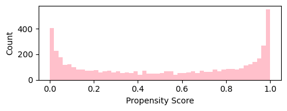
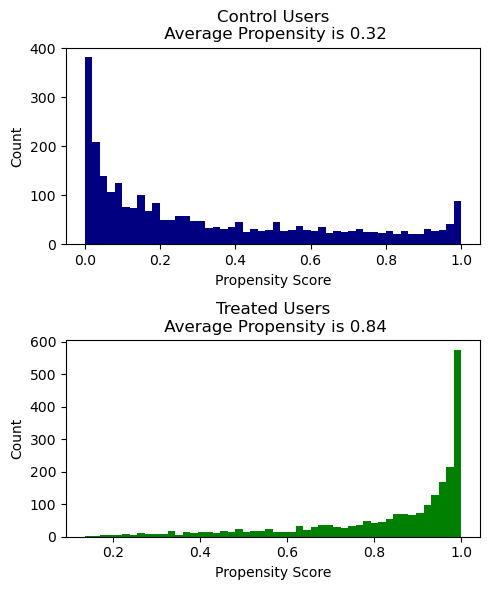
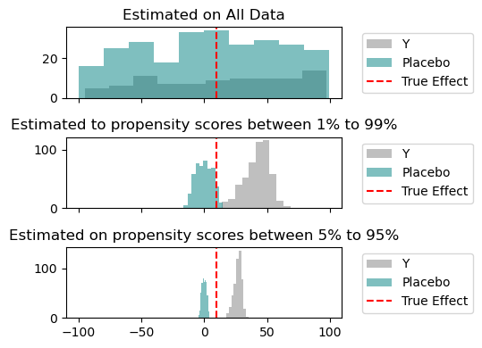

## Propensity Scores 
When we try to use non-experimental data to estimate causal effects, we rely on finding similar treatment and control groups. 
For example, we could be
estimating the impact of offering free cookies on subsequent health behavior. For each person we already offered free cookies for,
 we want to find a similar person that for some random reason, we did not offer cookies to.
  In randomized experiments, this is straight forward because you can
guarantee there are similar people you did and did not randomly offer cookies to. 

Outside of non-experimental data, we find people who were *arguably* randomly placed into treatment and control groups
 using propensity scores. 
The propensity score represents the probability a given user was placed into the treatment group. This is estimated based on
 user characteristics
and can be used to measure how similar they are to each other.

::: {.text-center}
**Propensity Scores Represent Probability of Treatment**

:::

As you might expect, control users tend to have lower propensity scores and treatment users tend to have higher propensity scores. 
This immediately presents a problem.
Since the distributions are so different between the groups, you *already know* that the treatment and control group are different. 

Suppose we have the distribution of propensity scores below, we see:

1. The average propensity scores are different between treatment and control (0.32 vs 0.84);

2. Not many control users have propensity scores above 0.60; and

3. Not many treated users have propensity scores below 0.40.

::: {.text-center}
**Propensity Scores Skew in Either Direction**

:::

A common way to correct this is to use inverse propensity weighting. This lets us equalize the treated and
control users. We will place more weight on control units with higher propensity scores to match 
that of treated users, and vice versa for treatment units.

Equation wise, this is done by dividing the outcomes by propensity scores. The treatment effect is calculated
as: 
$$ \text{Average}( \frac{\text{Treatment Outcome} }{\text{Propensity} } )  -  \text{Average}(\frac{\text{Control Outcome}}{1-\text{Propensity}})$$

## Dividing by Small Numbers and Why we need Trimming
An immediate problem is that we are dividing by propensity scores, which can have small values. This would consequentially
make the estimated impact very large and imprecise. 

Note the same problem is present in more advanced models like of double machine learning and doubly-robust models, that also involve dividing by propensity scores. 

A common way to address this is trimming: we remove control units with low values and treatment units with high values.

**But how low is too low, and how high is too high?**

Setting this parameter for causal inference problems is more challenging than in traditional prediction problems because there is 
no ground truth for evaluation. Since we do not know the *actual* treatment effect, we cannot judge different
trimming strategies. 

## Placebos can Provide Ground Truth
We can use a placebo outcome, where we can assume that the impact of the treatment is zero. Common placebo outcomes are
outcomes that we know are realized before the treatment. Others depend on subject matter expertise.

We show in this simulation notebook [link here](https://github.com/shoepaladin/causalinference_crashcourse/blob/main/OtherMaterial/General%20Points%20about%20Estimating%20Treatment%20Effect%20Models/Trimming%20Propensity%20Scores%20based%20on%20Placebo%20Results.ipynb) that when we use a placebo outcome we see that more aggressive trimming 
gets us closer to the "true" impact on zero. We can see this as we move down the figures and see more aggressive trimming, the estimated impact gets closer to the truth *and* the impact on the placebo outcome becomes more tightly clumped around zero. This can be used to tune how aggressively to trim your propensity scores.

The notebook also shows that training on a purely random number instead of a placebo outcome that is 
correlated with your features is misleading. The intuition there is a purely random number misses correlations between the propensity score and placebo that can also cause imprecise estimates.

::: {.text-center}
**Validate Trimming with Placebo Effects**

:::

A few caveats:

1. You'll need to trade-off accuracy and precision here. The simulation show that more aggressive trimming gets a more accurate estimate, but remember that this will also widen the confidence interval of your actual treatment estimate.

2. The treatment effect itself may vary over the propensity score. The simulation assumes a common treatment effect. If the likelihood of treatment correlates with the treatment effect, then one reason for large impact is that treatment units with low propensity scores actually do have large impacts. You will need heterogeneity analysis to address this issue.  

